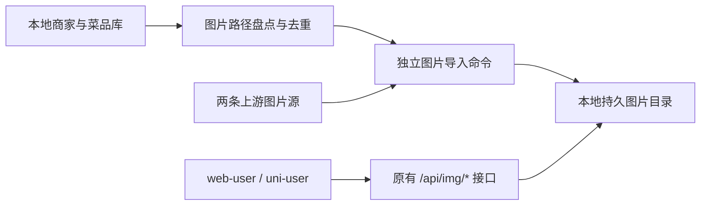

# 商家图片本地化方案与实施计划

> 日期：2026-11-06
> 状态：**2026-11-07 验收完成**（2026-11-06 代码实施，2026-11-07 环境恢复后真实下载与离线验收，验收中发现并补收口 food 分类页 `CategoryPanel.vue` 的 fuss10 直连漏点）。最终数字：唯一图片 10468 / 本地完整 10444（99.8%）/ 缺图 24（上游 404、HTML 假图、空 body，保持 404 属设计预期）/ 本地 150.17 MiB；幂等跳过、`--check` 离线盘点、断上游服务端字节一致性均通过。唯一未做：首页/商家页浏览器实机验收（无浏览器自动化环境，代码层已确认收口）。详见 `docs/reports/server/2026-11-06-商家图片本地化/engineering-report.md` §4.2 / §7。
> 来源：`docs/reports/server/2026-10-01-商家数据本地化/report.md` §9 第 2 项“图片字节仍走上游”。
> 范围：后端图片存储与导入、web-user 图片地址收口、离线验收与工程报告。

## 1. 要解决的问题

商家数据已经进入本地数据库，图片字节仍依赖外部服务。这会造成“商家列表能打开，图片却裂开”，与数据本地化的预期不一致。

目前有两条图片源：

| 资源 | 对外后端契约 | 当前上游 |
|------|--------------|----------|
| 商家图、菜品图 | `/api/img/<path>` | `ELM_API_BASE_URL` 下的 `/img/<path>` |
| 首页分类图 | `/api/img/cdn/<path>` | `https://fuss10.elemecdn.com/<path>` |

还存在一个前端接入缺口：uni-user 默认已经使用后端图片接口，web-user 默认仍直连上游。后端落盘和前端地址收口必须一起完成，才能验证用户页面上的图片本地化。

### 1.1 已确认的代码证据

| 证据 | 位置 | 含义 |
|------|------|------|
| 商家图片转发需要 `/img` 前缀 | `apps/server/src/modules/elm/services/elm-image-proxy.service.ts:27` | 导入下载时必须保留该映射 |
| 第二图片源是 fuss10 CDN | 同文件 `:45`、`:95` | 必须同时处理 `/cdn/` 命名空间 |
| 图片请求仍调用 `fetch` | 同文件 `:92` 起的 `getImage()` | 当前没有本地副本 |
| 现有超时收到响应头后即解除 | 同文件 `:133` | 本地化下载需要把超时覆盖到完整图片接收结束 |
| 通过首块嗅探图片格式 | 同文件 `:196` 起的 `sniffAndWrap()` | 保留按字节判断 MIME，修正只按第一网络块判断的问题 |
| 现有上传存储使用本地目录 | `apps/server/src/modules/storage/local-disk.storage.ts:6` | 可以沿用 `uploads/` 目录约定，无需引入存储 SDK |
| web-user 默认使用外部图片主机 | `apps/web-user/src/config/index.js:3` | 需要将默认值改为自身 API 地址 |
| web-user 首页图直连 CDN | `apps/web-user/src/views/msite/msite.vue:29` | 需要改走 `/img/cdn/` |
| uni-user 默认图片主机跟随 API | `apps/uni-user/src/config/index.ts:35` | 保留已有实现和当前未提交改动 |
| 前端占位图也使用上游图片路径 | `apps/web-user/src/config/index.js:21` | 必须预下载 `/187bcca1ec6114376.jpg`，避免原图缺失后占位图也失效 |

### 1.2 历史数据与本次实测的区别

原始报告记录：4295 家商家、1934 个菜品、308 个菜品分类、16 个首页分类。这些是 2026-10-01 的历史数量，不能直接当成本次图片数量：多条记录可能共用同一张图片，字段也可能为空。

本次只读连接 PostgreSQL 已执行，返回 `ECONNREFUSED`，当时 `localhost:5432` 未运行。因此本次尚未统计唯一图片数、图片总字节数、有效源比例和下载耗时。实施阶段必须实际读取现有库，报告只记录真实结果，不根据商家数估算图片体积。

## 2. 目标与边界

### 2.1 完成标准

1. 现有库引用的商家图、菜品图、首页分类图和前端默认占位图被盘点、去重并下载到本地。
2. `/api/img/*` 和 `/api/img/cdn/*` 保持 URL 形状；正常图片请求只读本地存储，不发起上游网络请求。
3. web-user 默认从本地后端读取商家图、菜品图及首页分类图；uni-user 保留当前后端图片接入方式。
4. 下载命令中断后可重跑；已经完整保存的文件跳过，半文件不对外提供。
5. 源图片已经失效时，缺失原因和关联记录可查询。不得把占位图保存到原始图片路径下并计为原图下载成功。
6. 上游不可达时，已导入图片在接口及真实页面中正常显示，错误响应不携带一年强缓存头。

### 2.2 本次不包含

- 商家表、菜品表或业务响应字段的迁移；数据库中的 `image_path` 保持原值。
- 管理端分页、逆地理编码、租户归属等原报告的其他遗留。
- 新增商家图片上传产品功能、对象存储 SDK、Redis 图片缓存或图片格式转换。
- 修改当前 uni-user 的页面、组件、配置等未提交工作。

管理端将来录入新的上游图片路径后，需要重跑导入命令才会发布对应图片；用户上传头像仍走现有 `/uploads/` 流程。

## 3. 方案选择

| 方案 | 优点 | 代价或问题 | 结论 |
|------|------|------------|------|
| 全量盘点预下载，运行时读本地文件 | 能覆盖未访问商家，运行时外部依赖明确消除；无新依赖 | 需要下载步骤和持久磁盘 | 推荐 |
| 访问时下载并缓存 | 初始下载较少 | 未访问商家离线仍缺图，运行时继续依赖上游 | 不采用 |
| 图片字节写入数据库或 Redis | 存储可集中管理 | 增加数据库备份或 Redis 内存负担，偏离已有文件存储方式 | 不采用 |
| 本次直接接对象存储 | 适合无持久盘的生产部署 | 需要额外服务、凭据、SDK 与运维，当前仓库已有本地文件存储 | 本次不采用；接口保留替换空间 |

本次改变原图片代理的“不落盘”决策。原决策考虑 Render 临时磁盘，现在用户明确要求图片本地化，部署必须相应配置持久存储。仅上传代码到 Render 不代表图片数据已经迁移。

## 4. 架构与数据流



图片导入访问上游；图片展示访问本地文件。正常请求不自动下载，也不自动重定向到第三方。

### 4.1 模块职责

| 模块 | 拟提供能力 | 依赖 |
|------|------------|------|
| `utils/elm-image.ts` | 路径归一化、校验、MIME 嗅探与文件键生成 | Node 标准库 |
| `ElmImageStorageService` | 本地文件读取、完整文件检测、原子保存 | 配置、文件系统 |
| `ElmImageProxyService` | 保持 `getImage()` 的本地读取契约；提供显式 `downloadImage()` | 本地存储、两条上游映射 |
| `ElmImageImportService` | 读取图片引用、去重、并发导入、失败清单与离线盘点 | Prisma、下载服务、本地存储 |
| `scripts/import-images.ts` | 独立命令入口、日志、退出码、连接关闭 | 上述服务的最小 Nest 上下文 |

命令入口只加载配置、Prisma 与图片相关 providers，不启动整个 `AppModule`，避免图片导入被 Redis、短信、支付等无关模块阻断。副作用导入沿用现有导入脚本的 `reflect-metadata`、dotenv 顺序约定。

### 4.2 存储目录与文件名

拟新增配置：

```dotenv
# 默认相对 apps/server 的工作目录解析；生产推荐持久卷的绝对路径
ELM_IMAGE_DIR=uploads/elm-images

# 复用现有配置，作用于每张图片完整下载过程
ELM_IMAGE_TIMEOUT_MS=15000
```

配置映射放在独立的 `elmImages.directory` 下，保持现有 `elmApi` 对象结构，避免牵动仅验证上游 URL 和超时的既有测试。

文件结构：

```text
apps/server/uploads/elm-images/
  <规范化路径的 SHA-256>.img
  .<SHA-256>.<随机标识>.tmp
  import-result.json
```

同目录临时文件全部写完并关闭后，再原子改名发布 `.img`。`.tmp` 不属于可读取资产，进程失败时不会把不完整图片误判为成功。`.img` 保存原始字节，响应 MIME 由文件字节判断，不使用扩展名推测。

文件键包含 `/cdn/` 前缀，因此 `/a.jpg` 和 `/cdn/a.jpg` 是不同资产。使用 hash 文件名也避免 Windows 大小写不敏感、保留文件名、路径分隔符等导致资产碰撞或越界。

默认目录已经被 `apps/server/uploads/` 忽略规则覆盖；不把下载的图片逐张提交到 Git。工程报告记录文件数与字节数，部署时单独迁移目录。

### 4.3 路径校验

规范化负责去掉首尾空白、统一单个前导 `/`，保留合法子目录和文件名大小写。校验在导入和 HTTP 读取时共用，不能只依赖 TypeScript 类型。

- 接受普通文件名、子目录、无点后缀的上游 hash 图片，以及 `/cdn/<path>`。
- 拒绝空路径、协议相对地址、外部 origin、反斜杠、NUL、控制字符、query/hash、`.` 与 `..` 路径段。
- HTTP 通配参数已经由 Express 解码，不再次解码；拒绝残留的编码逃逸路径。
- 输入若为绝对 URL，只允许盘点时转换已知的两条上游 origin，未知外部域名记录为无效引用，不进行下载。
- 不通过上游逐一试错猜测来源；默认路径补 `/img`，`/cdn/` 路径明确使用 fuss10 CDN。

最终允许的字符集合须用真实库路径盘点校核；合法历史图片不能仅因文件名格式与抽样不同而被静默过滤。

### 4.4 字节校验与下载限制

保留目前实际出现的 JPEG、PNG、WebP、GIF；按完整签名识别 MIME。PNG 校验完整 8 字节签名。网络第一块不足以识别格式时，继续累积到足够字节，避免小分块引起误判。

不再用 `image/*` 响应头或 `.jpg` 路径作为合法图片的充分条件：上游可能返回“200 + HTML”，或响应头声明 JPEG 而字节实际为 PNG。

导入下载约束：

- 同时最多下载 4 张，单张上限 10 MiB；最多约 40 MiB 的图片缓冲，不含框架开销。
- `ELM_IMAGE_TIMEOUT_MS` 覆盖响应头与完整 body 接收，成功落盘或失败后清理 timer、reader 和临时文件。
- `redirect: 'error'`，沿用已有 `resolveUpstreamUrl()` origin 检查；新增相对路径校验限制目录逃逸。
- 404、HTML、空 body、超限、超时、其他非成功响应和磁盘写入失败分别记录原因。
- 同一次执行不无限重试；重新运行命令即重试缺失或损坏文件。
- 同路径正常重跑不覆盖已校验文件，保持现有 `immutable` 缓存语义。

## 5. 图片盘点和失败处理

### 5.1 盘点来源

| 表 / 资源 | 字段或路径 | 命名空间 |
|-----------|------------|----------|
| `Restaurant` | `imagePath` | 默认 `/img` |
| `Restaurant.license` | `business_license_image`、`catering_service_license_image` 的非空字符串 | 默认 `/img` |
| `Restaurant.identification` | 先盘点 JSON 键和值类型，只收集明确的图片字段；非图片文字不当作路径 | 按实际字段的已知源 |
| `Food` | `imagePath` | 默认 `/img` |
| `FoodCategory` | `iconUrl` 的非空图片引用 | 按实际字段的已知源 |
| `CategoryEntry` | `imageUrl`、非空图片 `iconUrl` | 首页图使用 `/cdn/`，已知绝对 URL 按 origin 转换 |
| 前端公共占位图 | `/187bcca1ec6114376.jpg` | 默认 `/img` |

商家 `license` 字段名已有证据：`apps/server/src/modules/elm/types/elm.types.ts:49`；`identification` 只有泛型对象类型，不能凭字段名猜测全部字符串都是图片。实施第一步会保存实际图片字段盘点，并据此确定明确的提取映射。

只查询图片盘点所需字段；每条引用保留来源表、记录 ID 和字段名。去重后，同一下载路径仍可回溯到引用它的所有记录。

库为空时命令返回非零码并提示先执行商家数据导入，不能仅下载占位图就宣称全量完成。

### 5.2 拟新增命令

以下命令在实施后提供，当前尚不可执行：

```powershell
# 下载现有库引用的图片；不会重新抓取或覆盖商家数据
pnpm --filter @elm-platform/server run elm:import:images

# 只检查本地完整文件，不向任一上游发请求
pnpm --filter @elm-platform/server run elm:import:images -- --check
```

两种模式都打印：有效引用数、唯一图片数、本地完整数、本次下载数、缺失数、无效引用数、本地字节数与总耗时。

`import-result.json` 使用临时文件原子更新，包含执行时间、模式、统计和失败数组。失败项包含规范化路径、来源记录、失败分类和 HTTP 状态；不包含数据库密码、完整连接串或认证信息。

### 5.3 退出码和验收判定

| 状况 | 行为 |
|------|------|
| 有效图片全部完整，且无无效引用 | 退出 0 |
| 部分下载失败或离线盘点仍缺图 | 保存成功图片与失败清单，退出 1 |
| 数据库无法连接、数据为空或目录不可写 | 清晰报错，退出 1，不宣称完成 |
| 原字段为空 | 单独统计空引用，不当作下载失败；前端使用既有占位图 |

无法从上游找回的原图保持缺失状态，接口返回 404，前端沿用已有占位机制。最终报告必须区分“机制已完成”“原图有效覆盖率”“缺失图片”，存在缺失时不能声称全部原图已经本地化。

如果上游原图已经永久失效，是否用自有图片替换原始业务数据属于后续数据修复决策，本次不静默改写。

## 6. 对外接口与前端接入

### 6.1 图片接口

保留 `ProxiedImage { stream, contentType }` 与控制器返回 `rawResponse(new StreamableFile(stream))` 的结构，内部改为本地文件流。

| 场景 | 结果 |
|------|------|
| 本地完整图片 | 200，按 magic bytes 返回 `Content-Type`，保留一年 `immutable` 缓存 |
| 路径无效或本地不存在 | 404，无成功缓存头 |
| 本地文件损坏或读取失败 | 明确的服务端错误，无成功缓存头；不回源 |

`getImage()` 的本地逻辑必须在网络层不可用时也成立。控制器说明中的“代理上游”更新为“本地图片读取”，保留类名可减少无关引用变更。

### 6.2 web-user

仅做完成图片接入必要的两处改动：

1. `src/config/index.js` 的 `ELM_ASSET_HOST` 默认值从 `https://elm.cangdu.org` 改为 `API_BASE_URL`。保留 `VITE_ELM_ASSET_HOST` 显式覆盖能力；本地验收环境不设置第三方覆盖。
2. `src/views/msite/msite.vue` 的首页分类图片基地址改为 `${API_BASE_URL}/img/cdn`，按单斜杠拼接 `image_url`。

`getImageUrl()`、占位图、业务字段和页面结构保持原接口。显式传入的绝对图片 URL 仍按已有逻辑处理，验收时单独检查现有库是否存在这类绕过后端的引用。

实施 web-user 前读取其 `AGENTS.md`、`CLAUDE.md`，遵守 Vue 相关技能。当前用户要求先写文档，本阶段不修改任何 Vue 文件或配置。

### 6.3 uni-user 和管理端

uni-user 的默认图片路径已经跟随后端 API，验证已有图片入口即可。当前工作区有 uni-user 未提交改动，实施不覆盖这些文件。

管理端主要编辑 `image_path` 字符串，本次不扩展上传能力；其记录写入路径与导入资产发布分开，需在报告注明新增远程路径需运行导入命令。

## 7. 按顺序实施

| 阶段 | 文件 | 操作与完成标志 |
|------|------|----------------|
| 1. 实测基线 | 现有数据库和图片源，只读 | PostgreSQL 可连接后盘点全部引用，记录未知路径、JSON 图片键、唯一数量；探测两条源及占位图 |
| 2. 路径与存储 | 新增 `apps/server/src/modules/elm/utils/elm-image.ts`、`services/elm-image-storage.service.ts` | 实现共用归一化、校验、MIME、hash、本地读取和原子保存；失败不发布半文件 |
| 3. 本地接口和下载 | 修改 `services/elm-image-proxy.service.ts`、`controllers/elm-image-proxy.controller.ts`、`elm.module.ts` | `getImage()` 只读本地；`downloadImage()` 执行明确下载；注册 provider，保留响应契约 |
| 4. 配置和独立导入 | 修改 `apps/server/src/config/configuration.ts`、`env.schema.ts`、`apps/server/.env.example`、`apps/server/package.json`；新增 `services/elm-image-import.service.ts`、`scripts/import-images.ts` | 目录配置、4 并发、10 MiB 限制、失败清单、`--check`、正确退出码与连接释放 |
| 5. 前端接入 | 修改 `apps/web-user/src/config/index.js`、`src/views/msite/msite.vue` | 商家图和首页图默认都使用自身后端；页面网络中不再直连两条上游 |
| 6. 最小回归验证 | 新增 Elm 目录下必要的 utils/service tests，运行现有相关 tests | 按下一节的行为验证；不引入新的测试框架或覆盖率目标 |
| 7. 导入和离线验收 | 本地图片目录与实际 API / 页面 | 真正批量下载，重跑验证跳过，禁用两条上游后验证图片显示与零网络调用 |
| 8. 收尾留档 | 原始报告 §9 第 2 项、`docs/reports/server/2026-11-06-商家图片本地化/engineering-report.md`、`docs/reports/README.md`、本计划 | 仅在有真实验证证据后更新完成状态，记录缺图、文件/行数/体积/耗时及回滚 |

实施清单：

- [x] 实测当前库的图片引用与源可用性。（2026-11-07 环境恢复后实测：有效引用 10690 / 空 0 / 无效 348，唯一图片 10466；`--check` 离线盘点 3.8s 完成）
- [x] 完成本地存储、独立下载和导入命令。（2026-11-06 已落地 `elm-image.ts` / `elm-image-storage.service.ts` / `downloadImage` / `elm-image-import.service.ts` / `import-images.ts` + `elm:import:images` 脚本；2026-11-07 验收发现 `ts-node` 不解析 `@/` 别名，已给 `prisma:seed` / `elm:import` / `elm:import:images` 脚本统一加 `-r tsconfig-paths/register`）
- [x] 完成 web-user 图片源收口。（2026-11-06 已收口 `config/index.js`、`msite.vue`，另清掉 `imageLoading.js` 默认回退源。**2026-11-07 验收发现并补收口**：`food` 分类页 `CategoryPanel.vue` 原硬编码 `fuss10.elemecdn.com` 直连，已改走 `${API_BASE_URL}/img/cdn/`；其数据源工厂 `createRestaurantCategory` 硬编码的 2 张 CDN 类目图提成常量 `CDN_CATEGORY_IMAGE_TAILS`（`elm-image.ts`）并纳入 `elm:import:images` 预下载，补下载后唯一图片 10468 / 本地完整 10444）
- [x] 通过最小自动化回归、lint、类型检查与 build。（2026-11-06：后端 tsc/build 过、92 测试过（含新增 43 用例）、web-user type-check/lint/build 过、77 测试过）
- [x] 执行真实批量下载、重跑盘点和断上游验收。（2026-11-07：首轮 10354/10466（1207.5s）→ 并发 16 重试 +78 → 并发 4 重试 +10，收敛缺图 24（上游不可得：404×7 / HTML×9 / 空 body×8）；重跑 `本次下载 0 / 跳过已完整 10442` 幂等通过；`--check` 离线盘点 10442/10442 完整；断上游（`ELM_API_BASE_URL` 指死主机）下完整图 200 且服务端字节与本地资产逐字节一致、CDN 命名空间不串图、缺失图 404 且无 `immutable` 头。**未做**：首页/商家页浏览器实机验收（无浏览器自动化环境），仅代码层确认收口 + dist 产物字面量排查（除 CategoryPanel 外无上游域名））
- [x] 更新原报告待办并生成工程报告和索引。（2026-11-06：原报告 §9 第 2 项已标注"代码已实施、实际下载与离线验收待环境恢复"；`docs/reports/server/2026-11-06-商家图片本地化/engineering-report.md` 与 `docs/reports/README.md` 已登记。2026-11-07：§4.2 已补真实数字，状态行改 ✅，遗留 2 项（CategoryPanel 收口 / 浏览器实机验收）记入 §7 待办）

## 8. 验证计划

本节是将来实施时要执行的验证，不代表当前已经通过。文档阶段只检查内容一致性，不执行代码测试、下载或批量写入数据库。

### 8.1 测试准入与必要行为

遵守 `AI_TEST_POLICY.md`：路径/MIME 工具函数符合第 1 条；原子写入、并发、失败恢复符合第 2 条；已落盘图片仍因上游不可用而加载失败的回归符合第 5 条。只覆盖以下行为，不为配置常量或简单文案另写测试：

- 已保存的默认图和 `/cdn/` 图，在 `fetch` 被设置为必定抛错时仍可完整读取，且 `fetch` 调用次数为 0。
- 相同尾路径的默认源/CDN 不串图；合法子目录和无点后缀可读取。
- 路径穿越、反斜杠、协议相对路径和未知 origin 不产生网络或越界文件操作。
- HTML 假图片、空 body、错误 MIME、分块不足、超时、超限被正确处理。
- 下载中途失败不留下可读取的完整文件；重复执行跳过有效图片，仅重试缺失或损坏文件。
- 离线 `--check` 不下载；失败清单包含来源，缺图和无效引用使结果不通过。

### 8.2 实施后的检查命令

统一从仓库根运行：

```powershell
pnpm --filter @elm-platform/server run lint
pnpm --filter @elm-platform/server exec tsc --noEmit -p tsconfig.json
pnpm --filter @elm-platform/server run build

# 新增测试文件按实现最终命名；以下命名对应本计划
pnpm --filter @elm-platform/server run test -- --runInBand elm-image

# 回归现有图片相关控制器和配置；按实际目录匹配
pnpm --filter @elm-platform/server run test -- --runInBand elm-upstream-public.controller elm-api-config

pnpm --filter @elm-platform/web-user run lint
pnpm --filter @elm-platform/web-user run type-check
pnpm --filter @elm-platform/web-user run build

pnpm --filter @elm-platform/server run elm:import:images
pnpm --filter @elm-platform/server run elm:import:images -- --check
```

Jest 使用 `--runInBand`，避免原报告记载的多 worker 内存叠加问题。不因为本次小范围前端配置调整创建组件测试；页面实际图片请求由人工/浏览器 smoke check 验证。

### 8.3 离线验收

1. 导入后保存一次盘点结果，记录各类成功图片和缺失数量。
2. 在独立验收实例中让 `ELM_API_BASE_URL` 不可达，并同时禁用外部 CDN 请求。只禁用默认源不足以证明首页图离线可用。
3. 绕过浏览器图片缓存或使用新会话，读取商家图、菜品图、首页分类图、默认占位图；核对 MIME 与字节一致性。
4. 在 web-user 实际打开首页和有菜品的商家页，核对请求均走自身后端；确认 uni-user 原图片入口兼容。
5. 请求缺失及无效路径，确认错误状态正确且没有 `immutable` 成功缓存头。
6. 再跑 `--check`，确认没有任何上游请求，缺失仍如实显示。

## 9. 切换、部署与回滚

### 9.1 切换顺序

先完成代码检查和图片下载，确认资产目录及覆盖情况，再把正常运行实例切到本地图片实现。不能先重启成“只读本地”而目录仍为空。

若下载失败，保留成功资产和清单，继续重跑；未达到验收标准时，不将原报告写成“全量完成”。

### 9.2 部署与备份

- 把图片目录与本地数据库视为配套数据备份；只备份商家表不能恢复图片。
- 生产设置 `ELM_IMAGE_DIR` 指向持久卷绝对路径，并将下载目录复制到该位置。
- 多实例部署使用同一可访问的持久目录，或各实例同步完整副本；临时磁盘重启后会丢图。
- 保留当前上传目录的权限与隔离方式，不把导入结果清单作为公网静态资源暴露。
- `VITE_ELM_ASSET_HOST` 若显式设置为第三方源，会覆盖 web-user 本地默认值，部署验收需要检查该配置。

### 9.3 回滚

本次不做数据库迁移，因此回滚代码即可恢复原图片转发行为。部署保留上一个版本：

1. 将后端切回原图片服务及 provider/配置，恢复原 `apps/server/package.json`；仅回退本任务改动，不使用 `git reset --hard`。
2. 如需恢复前端旧行为，回退本任务修改的 web-user 配置与首页图片基地址。
3. 保留本地图片目录，不主动删除，方便修复后重新上线。
4. 重新执行对应 lint、类型检查和 build，确认上游可达后做原图片接口 smoke check。

实施报告会依据最终实际变更文件补充精确回滚清单，不把当前已有的 uni-user 和工程文档改动混入回滚范围。

## 10. 当前文档阶段交付

已完成：原待办与代码链路核对、两个图片源识别、web-user 接入缺口识别、方案比较、实施范围、失败处理、验证与回滚计划。

尚未执行：业务代码修改、自动化测试变更、图片下载、生产部署、将原报告待办标为完成。用于只读连接检查的临时脚本已移除。

实施阶段的首个前置条件是恢复已有 PostgreSQL 并盘点真实图片引用；数量、耗时和缺图率以当次实测为准。
